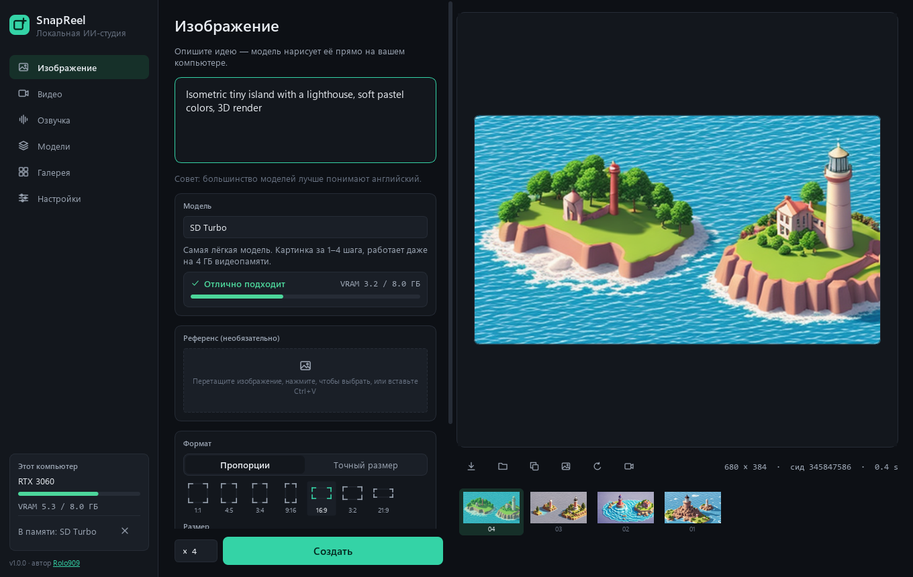
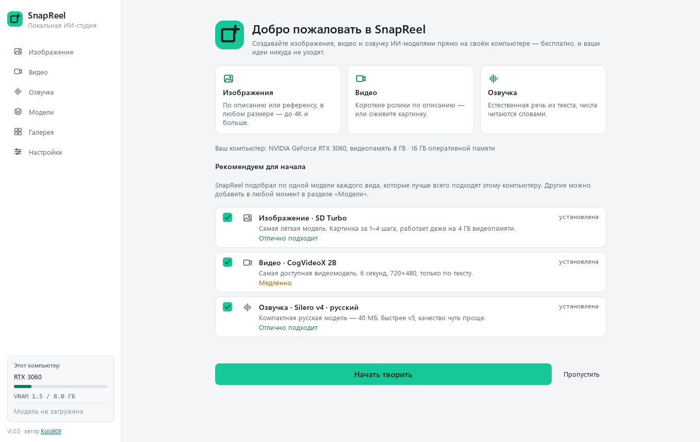
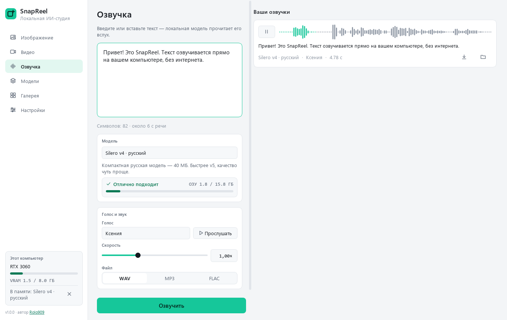
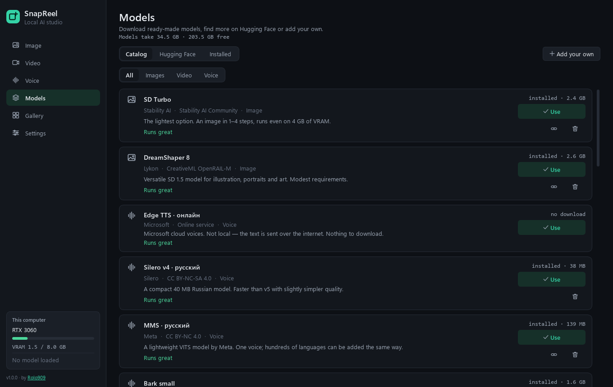

<p align="center">
  
</p>

<h1 align="center">SnapReel</h1>

<p align="center">
  Локальная ИИ-студия: изображения, видео и озвучка прямо на вашем компьютере.<br>
  A local AI studio: images, video and voice-overs on your own computer.
</p>

<p align="center">
  <a href="#русский">Русский</a> · <a href="#english">English</a>
</p>

<p align="center">
  
</p>

---

<a name="русский"></a>

## Русский

SnapReel запускает открытые ИИ-модели у вас на компьютере. Интернет нужен только чтобы один раз скачать
программу и модели: ваши идеи, тексты и результаты никуда не отправляются. Подписок и лимитов нет.

- **Изображения** по описанию или по картинке-референсу (IP-Adapter), с LoRA. Размер до 4K и больше:
  если модель не умеет такой размер, SnapReel создаст картинку поменьше и аккуратно увеличит её (Real-ESRGAN).
- **Видео**: короткие ролики по описанию или «оживление» картинки (CogVideoX, Wan, LTX-Video).
- **Озвучка**: естественная речь из текста на русском и английском (Silero, MMS, Bark). Числа, даты и
  сокращения читаются словами.
- **Подбор под ваш компьютер.** SnapReel заранее говорит, как модель пойдёт на вашей видеокарте
  («отлично», «медленно», «не хватит памяти»), и сам выбирает режим: целиком в видеопамяти, с выгрузкой
  в оперативную память или по частям. Модели, которые больше видеопамяти, всё равно запускаются.
- **Каталог моделей** с поиском по Hugging Face, докачкой после обрыва и проверкой места на диске.
  Можно добавить свою модель из файла `.safetensors` или папки.
- Тёмная и светлая темы, русский и английский интерфейс (переключаются в «Настройках»).

<p align="center">
  
  
</p>

### Установка (Windows 10/11)

Ничего заранее ставить не нужно — ни Python, ни драйверы CUDA, ни командную строку.

1. Скачайте архив `SnapReel-<версия>-windows.zip` со страницы
   [Releases](https://github.com/Rolo909/SnapReel/releases) и **распакуйте** его, например в `D:\SnapReel`.
2. Дважды щёлкните **`SnapReel.cmd`**.
   Если Windows покажет «Windows защитила ваш компьютер» — нажмите **«Подробнее» → «Выполнить в любом случае»**.
   Это обычное предупреждение для бесплатных программ без платной подписи.
3. Откроется окно «Подготовка к первому запуску». SnapReel сам определит видеокарту и скачает нужное:
   около 3 ГБ для NVIDIA, около 1 ГБ для остальных компьютеров. Если загрузка прервётся — просто
   запустите `SnapReel.cmd` ещё раз, она продолжится.
4. Готово: на рабочем столе и в «Пуске» появится ярлык. При первом запуске SnapReel предложит
   по одной модели каждого вида, которые лучше всего подходят вашему компьютеру.

Всё ставится внутрь папки SnapReel, системный Python не затрагивается. **Удаление** — удалите папку,
ярлыки и, при желании, настройки в `%APPDATA%\SnapReel`. **Обновление** — распакуйте новую версию поверх
старой: модели и работы останутся. О новой версии SnapReel сообщит сам (можно отключить в «Настройках»).

### Какая модель подойдёт моему компьютеру

Оценка SnapReel для картинки 1024×1024 (у SD Turbo и DreamShaper — их родной 512/768) и стандартной длины
ролика. «Медленно» обычно значит, что модель не помещается в видеопамять целиком и SnapReel подгружает её
по частям.

| Модель | Скачать | Без видеокарты (16 ГБ ОЗУ) | 6 ГБ | 8 ГБ | 12 ГБ | 16 ГБ | 24 ГБ |
|---|---|---|---|---|---|---|---|
| SD Turbo | 2.6 ГБ | медленно | отлично | отлично | отлично | отлично | отлично |
| DreamShaper 8 | 2.8 ГБ | медленно | отлично | отлично | отлично | отлично | отлично |
| SDXL Turbo | 7.0 ГБ | очень медленно | хорошо | хорошо | отлично | отлично | отлично |
| Stable Diffusion XL | 7.0 ГБ | очень медленно | медленно | хорошо | отлично | отлично | отлично |
| Sana Sprint 0.6B | 7.7 ГБ | очень медленно | хорошо | хорошо | отлично | отлично | отлично |
| FLUX.2 klein 4B | 16 ГБ | нет | очень медленно | очень медленно | хорошо | хорошо | отлично |
| Z-Image Turbo | 33 ГБ | нет | очень медленно | очень медленно | медленно | хорошо | отлично |
| FLUX.1 schnell | 34 ГБ | нет | нет | нет | очень медленно | очень медленно | медленно |
| CogVideoX 2B (видео) | 14 ГБ | нет | медленно | медленно | хорошо | хорошо | отлично |
| Wan 2.1 1.3B (видео) | 29 ГБ | нет | очень медленно | очень медленно | хорошо | хорошо | отлично |
| LTX-Video 2B (видео) | 28 ГБ | нет | медленно | медленно | хорошо | хорошо | отлично |
| Wan 2.2 5B (видео) | 34 ГБ | нет | нет | нет | медленно | медленно | хорошо |
| CogVideoX 5B I2V (видео) | 22 ГБ | нет | нет | нет | медленно | хорошо | хорошо |
| Silero, MMS (озвучка) | 0.04–0.15 ГБ | отлично | отлично | отлично | отлично | отлично | отлично |
| Bark small (озвучка) | 1.7 ГБ | медленно | отлично | отлично | отлично | отлично | отлично |

Для 6 и 8 ГБ видеопамяти взято 16 ГБ оперативной памяти, для 12–16 ГБ — 32 ГБ, для 24 ГБ — 64 ГБ.
Видеокарты: NVIDIA (CUDA). На компьютерах без NVIDIA SnapReel работает на процессоре.

### Где лежат файлы

| Что | Где |
|---|---|
| Модели | `SnapReel\models` (рядом с `SnapReel.cmd`; можно сменить в «Настройках») |
| Результаты | `SnapReel\output` |
| Настройки, история, журналы, плагины | `%APPDATA%\SnapReel` |

### Частые вопросы

**Генерация идёт очень долго.** Посмотрите оценку под выбором модели. Если там «медленно» — модель
не помещается в видеопамять; выберите модель полегче (SD Turbo, SDXL Turbo, CogVideoX 2B) или уменьшите размер.

**Есть видеокарта NVIDIA, а SnapReel пишет «процессор».** Обновите драйвер NVIDIA (нужен 580 или новее)
и нажмите «Установить GPU-версию PyTorch» в «Настройки → Этот компьютер».

**Хочу свою модель.** «Модели → Добавить свою»: поиск по Hugging Face или свой файл `.safetensors` / папка
diffusers. LoRA добавляются так же. Для моделей, которые встроенные движки не умеют запускать, есть
[плагины](docs/PLUGINS.md).

**Нужен ли интернет для работы?** Нет — только для загрузки моделей и проверки обновлений.
Единственное исключение — необязательный онлайн-голос Edge TTS.

### Запуск из исходного кода

Нужен [uv](https://docs.astral.sh/uv/). Python нужной версии uv поставит сам.

```bash
git clone https://github.com/Rolo909/SnapReel.git
cd SnapReel
uv sync --extra cu130 --extra online   # NVIDIA; без видеокарты: --extra cpu
uv run python -m snapreel
```

Тесты и проверка стиля:

```bash
uv run pytest
uv run ruff check src tests
```

Сборка релизного архива: `uv run python scripts/build_release.py` → `dist/SnapReel-<версия>-windows.zip`.
Устройство проекта: интерфейс (`gui`) → фоновые задачи (`workers`) → движки моделей (`engines`) → ядро (`core`).

### Лицензии

Код SnapReel распространяется по лицензии [MIT](LICENSE). **На модели она не распространяется**: у каждой
модели своя лицензия, она показана в каталоге. Некоторые разрешают только некоммерческое использование —
например Silero (CC BY-NC-SA 4.0), MMS (CC BY-NC 4.0) и SD Turbo / SDXL Turbo (Stability AI Community).
Перед коммерческим использованием результата проверьте лицензию модели. Real-ESRGAN — BSD-3-Clause.

### Автор

Автор реализации — **Rolo909**: [github.com/Rolo909](https://github.com/Rolo909).

---

<a name="english"></a>

## English

SnapReel runs open AI models on your own computer. The internet is only needed once, to download the app
and the models: your ideas, texts and results never leave your machine. No subscriptions, no limits.

- **Images** from a description or a reference picture (IP-Adapter), with LoRA. Up to 4K and beyond:
  when a model can't render that size, SnapReel renders smaller and upscales carefully (Real-ESRGAN).
- **Video**: short clips from a description, or bring a picture to life (CogVideoX, Wan, LTX-Video).
- **Voice-over**: natural speech from Russian and English text (Silero, MMS, Bark). Numbers, dates and
  abbreviations are read as words.
- **Fitted to your computer.** SnapReel tells you up front how a model will run on your graphics card
  ("great", "slow", "not enough memory") and picks the mode by itself: fully in video memory, offloaded to
  RAM, or streamed piece by piece. Models larger than your video memory still run.
- **Model catalog** with Hugging Face search, resumable downloads and disk-space checks. Add your own
  model from a `.safetensors` file or a folder.
- Dark and light themes, Russian and English interface (switch in Settings).

<p align="center">
  
</p>

### Install (Windows 10/11)

Nothing to install beforehand — no Python, no CUDA, no command line.

1. Download `SnapReel-<version>-windows.zip` from [Releases](https://github.com/Rolo909/SnapReel/releases)
   and **unpack** it, e.g. to `D:\SnapReel`.
2. Double-click **`SnapReel.cmd`**.
   If Windows shows "Windows protected your PC", click **More info → Run anyway**. This is a usual
   warning for free programs without a paid signature.
3. The "Getting ready for the first start" window opens. SnapReel detects your graphics card and downloads
   what it needs: about 3 GB for NVIDIA, about 1 GB for other computers. If the download is interrupted,
   just start `SnapReel.cmd` again — it continues.
4. Done: a shortcut appears on the desktop and in the Start menu. On the first start SnapReel suggests one
   model of each kind that suits your computer best.

Everything goes inside the SnapReel folder; your system Python is not touched. **Remove** — delete the folder,
the shortcuts and, optionally, the settings in `%APPDATA%\SnapReel`. **Update** — unpack the new version over
the old one: models and results stay. SnapReel tells you when a new version is out (can be turned off in Settings).

### Which model suits my computer

The verdicts are those of the [table above](#какая-модель-подойдёт-моему-компьютеру):
*отлично* = great, *хорошо* = good, *медленно* = slow, *очень медленно* = very slow, *нет* = won't run.
Estimated for a 1024×1024 picture (SD Turbo and DreamShaper at their native 512/768) and the default clip
length; 6–8 GB cards with 16 GB RAM, 12–16 GB with 32 GB, 24 GB with 64 GB. "Slow" usually means the model
doesn't fit in video memory and SnapReel streams it. GPUs: NVIDIA (CUDA); other computers run on the CPU.

### Where files live

| What | Where |
|---|---|
| Models | `SnapReel\models` (next to `SnapReel.cmd`; can be changed in Settings) |
| Results | `SnapReel\output` |
| Settings, history, logs, plugins | `%APPDATA%\SnapReel` |

### FAQ

**Generation is very slow.** Check the estimate under the model picker. "Slow" means the model doesn't fit in
video memory: choose a lighter one (SD Turbo, SDXL Turbo, CogVideoX 2B) or a smaller size.

**I have an NVIDIA card but SnapReel says "CPU".** Update the NVIDIA driver (580 or newer) and press
"Install the GPU version of PyTorch" in Settings → This computer.

**I want my own model.** Models → Add your own: search Hugging Face or pick a `.safetensors` file / diffusers folder.
LoRAs are added the same way. For models the built-in engines can't run there are [plugins](docs/PLUGINS.md).

**Does it need the internet to work?** No — only to download models and check for updates.
The one exception is the optional online Edge TTS voice.

### Run from source

You need [uv](https://docs.astral.sh/uv/); it installs the right Python by itself.

```bash
git clone https://github.com/Rolo909/SnapReel.git
cd SnapReel
uv sync --extra cu130 --extra online   # NVIDIA; without one: --extra cpu
uv run python -m snapreel
```

Tests and lint: `uv run pytest`, `uv run ruff check src tests`.
Release archive: `uv run python scripts/build_release.py` → `dist/SnapReel-<version>-windows.zip`.
Layout: UI (`gui`) → background jobs (`workers`) → model engines (`engines`) → core (`core`).

### Licenses

SnapReel's code is [MIT](LICENSE)-licensed. **That does not cover the models**: each model has its own license,
shown in the catalog. Some allow non-commercial use only — e.g. Silero (CC BY-NC-SA 4.0), MMS (CC BY-NC 4.0)
and SD Turbo / SDXL Turbo (Stability AI Community). Check the model's license before using results commercially.
Real-ESRGAN is BSD-3-Clause.

### Author

Implemented by **Rolo909**: [github.com/Rolo909](https://github.com/Rolo909).
